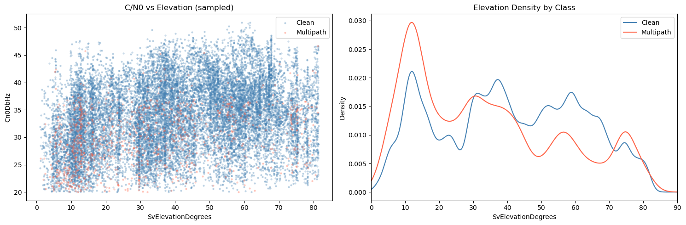

# SDC-2022: Second-Generation Replication

## Problem

Does the multipath signature found in SDC-2023 hold on a different competition year, with a different mix of devices? This pipeline exists as a **replication check**: if the elevation and C/N₀ relationships reappear across a separate data collection with five device models instead of three, the signature is a property of the physics rather than of one dataset.

## Data

**Google Smartphone Decimeter Challenge 2022**: same `device_gnss.csv` format as 2023, earlier collection.

| | |
|---|---|
| Feature table | 592,004 rows · 7 of 9 sessions |
| Multipath rate | ~5.6% |
| Devices | mi8, pixel6pro, pixel7, pixel7pro, sm-g988b, samsungs21ultra |

Two of the nine sessions are dropped: their devices never populate `MultipathIndicator`, so they carry no usable label.

Download from [kaggle.com/competitions/google-smartphone-decimeter-challenge](https://www.kaggle.com/competitions/google-smartphone-decimeter-challenge) into `data/01_raw/`.

## Method

| Notebook | What it does |
|---|---|
| `01_2022_data_parser.ipynb` | Parses the 2022 logs to per-measurement epochs → `data/02_interim/sdc2022_epochs.csv` |
| `02_2022_eda.ipynb` | Target distribution, feature boxplots by class, elevation × C/N₀, constellation breakdown, correlation analysis |
| `03_2022_classification.ipynb` | Feature engineering → `data/03_processed/sdc2022_training_features.csv`, RF / HistGBM / linear baselines |
| `2022_mapping.ipynb` | Folium route maps per session |

Deliberately mirrors the 2023 notebook structure cell-for-cell so the two EDAs are directly comparable.

## Results

The signature replicates. Multipath concentrates at low elevation and depressed C/N₀ in exactly the pattern SDC-2023 shows, on an independent collection with a partly different device fleet:

<p align="center">
  
</p>

The constellation breakdown also reproduces the 2023 bias (some constellations are flagged far more often than their geometry justifies), which is corroborating evidence that `MultipathIndicator` is a **device-reported, constellation-dependent** quantity and not a clean physical label. That observation is what motivates `analysis/residual_label_integrity.ipynb`.

> **`03_2022_classification.ipynb` has no stored outputs,** and like its 2023 counterpart it uses a stratified random row split, which leaks for temporally autocorrelated labels. No classification metric is quoted from it here. For trustworthy held-out-drive numbers on SDC data, use `2023_notebooks/04_2023_routen_deepdive.ipynb` and `analysis/interpretability_baselines.ipynb`.

This pipeline's contribution is the **EDA replication**, not a competitive classifier.

## How to run

Needs `data/01_raw/` populated with the 2022 competition data.

```bash
cd GNSS_Multipath_Project/notebooks_python/2022_notebooks
jupyter lab
```

In order:

1. `01_2022_data_parser.ipynb` → `data/02_interim/sdc2022_epochs.csv`
2. `02_2022_eda.ipynb`
3. `03_2022_classification.ipynb` → `data/03_processed/sdc2022_training_features.csv`

Headless:

```bash
python -m nbconvert --to notebook --execute --inplace 01_2022_data_parser.ipynb
```

`2022_mapping.ipynb` is independent of 03 and needs a live browser for Folium tiles.
