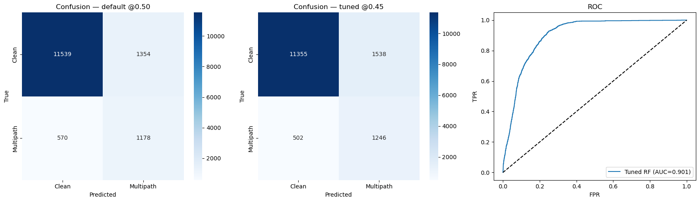
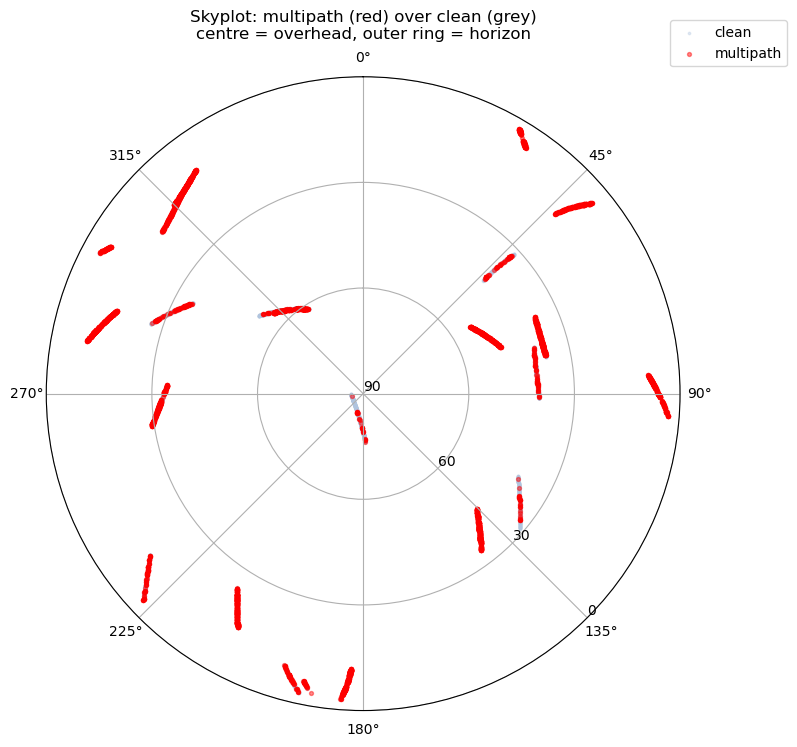

# SDC-2023: Detection Pipeline & Single-Drive Deep Dive

The primary pipeline of the project. Everything downstream (transfer, attention, positioning, label analysis) is built on the feature tables these notebooks produce.

## Problem

Can multipath be identified in a single GNSS measurement from its signal quality and geometry alone, and does a model trained on some drives still work on drives it has never seen? The second half matters more than the first: a detector that has memorised *where* multipath happens is useless anywhere else, so no location feature is ever given to the model and validation is always by held-out drive.

## Data

**Google Smartphone Decimeter Challenge 2023**: real smartphone GNSS logs (`device_gnss.csv`) with the device-reported `MultipathIndicator` as the label, plus ground-truth trajectories.

| | |
|---|---|
| Parsed | 761,597 measurements · 17 sessions · ~7.0% multipath |
| After feature cleaning | 721,832 rows · ~6.3% multipath |
| Devices populating the flag | pixel6pro, pixel7pro, sm-g955f |
| Deep-dive session (`routen`, pixel6pro) | 77,365 → 48,809 rows · ~12% multipath |

Download from [kaggle.com/competitions/smartphone-decimeter-2023](https://www.kaggle.com/competitions/smartphone-decimeter-2023) into `data/01_raw/sdc2023/`.

> The label means *detected multipath*, not strictly NLOS, and it is constellation-biased. `analysis/residual_label_integrity.ipynb` quantifies how weakly it tracks real measurement error. Read that before trusting any F1 here.

## Method

| Notebook | What it does |
|---|---|
| `01_2023_data_parser.ipynb` | Reads the raw SDC logs, flattens to per-measurement epochs, writes `data/02_interim/sdc2023_epochs.csv` |
| `02_2023_eda.ipynb` | Class balance, feature distributions by class, the elevation × C/N₀ signature, constellation breakdown, correlation, PCA |
| `03_2023_classification.ipynb` | Feature engineering (24 features: elevation/C/N₀ categories, constellation one-hots, receiver uncertainties) → `data/03_processed/sdc2023_training_features.csv`, plus a first-pass classifier |
| `04_2023_routen_deepdive.ipynb` | **The showcase.** One drive end-to-end: route map → EDA (per-satellite, elevation × constellation, skyplot) → Optuna-tuned RF + threshold tuning + LogReg baseline → SHAP → cross-route validation → coordinate spot-check |
| `2023_mapping.ipynb` | Folium route maps coloured by multipath intensity |

The deep dive uses a **temporal split** within the session (train 34,168 / test 14,641, both 11.9% multipath) and then validates on three entirely separate drives.

> `03_2023_classification.ipynb` uses a stratified random row split, which leaks for temporally autocorrelated labels, and has no stored outputs. Treat it as the feature-engineering step; quote the deep dive's held-out numbers instead.

## Results

**Tuned Random Forest** (Optuna: `n_estimators=300, max_depth=25, min_samples_leaf=4, min_samples_split=16, max_features='sqrt'`; CV F1 0.605):

| Model | Test F1 | Notes |
|---|---|---|
| Baseline RF | 0.501 | default hyperparameters |
| Optuna-tuned RF @ 0.50 | **0.551** | accuracy 0.86 |
| Optuna-tuned RF @ 0.455 | 0.550 | recall **0.71**, the operating point worth using |
| Logistic regression | 0.483 | AUC 0.874 |

Tuned RF per class: Clean P 0.96 / R 0.88 · Multipath P 0.45 / R 0.71 / F1 0.55.

<p align="center">
  
</p>

**Cross-route validation**: the model trained on the `routen` drive, applied to three drives it has never seen:

| Unseen drive | rows | % multipath | F1 | recall | ROC-AUC |
|---|---|---|---|---|---|
| `…22-47-routebc2` | 60,714 | 10.8 | 0.515 | 0.75 | **0.900** |
| `…09-06-18-47` | 42,257 | 7.9 | 0.474 | 0.58 | **0.898** |
| `…03-08-mtv-u` | 25,664 | 10.6 | 0.421 | 0.73 | **0.839** |

AUC holds; F1 drops because the positive rate differs and the threshold was tuned elsewhere. With no location feature available, this is evidence the model keys on physics rather than place.

**What it learned (SHAP, 24 features):** `RawPseudorangeUncertaintyMeters` 0.143 · `ReceivedSvTimeUncertaintyNanos` 0.085 · `Const_Galileo` 0.068 · `RawPseudorangeMeters` 0.045 · `Elev_Category_VeryLow` 0.031 · `Cn0_Category_Medium` 0.030.

The receiver's own uncertainty estimates dominate; the chipset already partly knows. Constellation ranks third, which is the label bias showing through, not physics.

**EDA findings worth keeping:**

- **Elevation**: multipath rate falls monotonically: 0–15° **15.3%** · 15–30° 11.3% · 30–45° 9.4% · 45–60° 5.8% · 60–90° **4.3%**. The lowest bin is 43% of all multipath from 29% of measurements.
- **Per-satellite**: all 11 Galileo satellites are flagged, 21.7% rate, the largest single contributor. QZSS Svid 195 at 6.5° elevation hits 24%.
- **Matched elevation (Galileo vs GPS)**: 0–15°: 28.4% vs 8.3%; 45–60°: 12.2% vs 0.9%. High-elevation Galileo exceeds low-elevation GPS, so this is a label artefact, not geometry.
- **Azimuth**: N-NE 20.3% vs E-SE 5.0%, i.e. direction-specific building reflections.

<p align="center">
  
</p>

**Map agreement** (actual vs predicted, per-epoch multipath fraction): MAE ≈ 0.05–0.08, Pearson r ≈ 0.30–0.37, epoch-level "any multipath?" agreement **97.9%**.

## How to run

Needs `data/01_raw/sdc2023/` populated. From the repository root with the environment active:

```bash
cd GNSS_Multipath_Project/notebooks_python/2023_notebooks
jupyter lab
```

Run in order; each reads the previous one's cache:

1. `01_2023_data_parser.ipynb` → writes `data/02_interim/sdc2023_epochs.csv`
2. `02_2023_eda.ipynb`
3. `03_2023_classification.ipynb` → writes `data/03_processed/sdc2023_training_features.csv`
4. `04_2023_routen_deepdive.ipynb`, standalone once step 1 has run

Headless:

```bash
python -m nbconvert --to notebook --execute --inplace 01_2023_data_parser.ipynb
```

The deep dive runs an Optuna study and SHAP over a large frame; budget ~20–30 minutes. `2023_mapping.ipynb` renders Folium maps and needs a live browser to display tiles.
