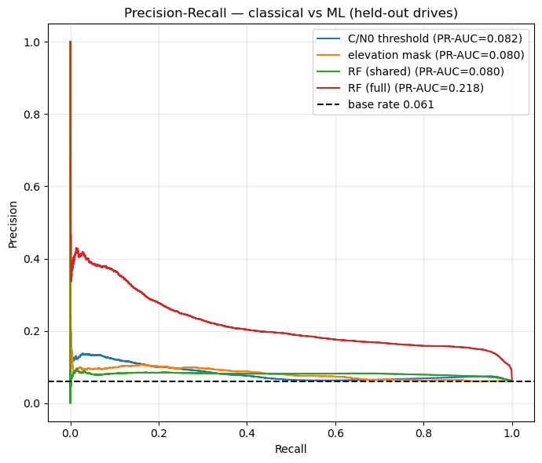
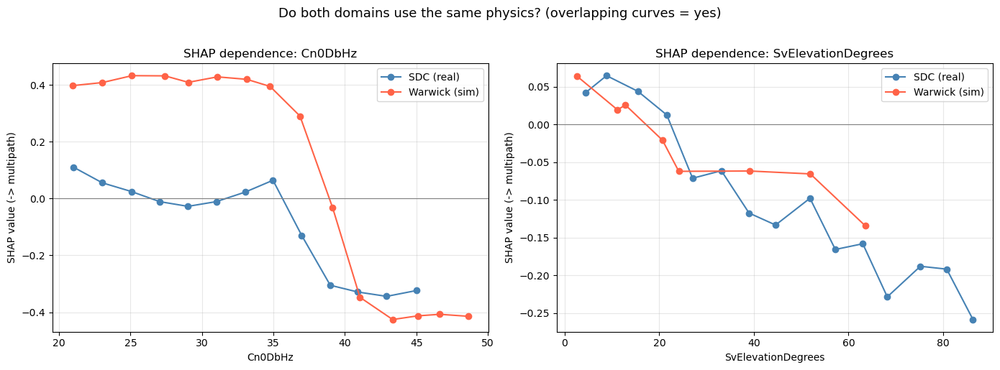
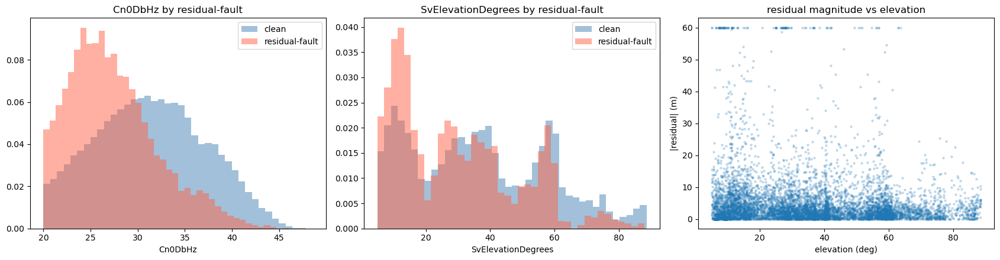
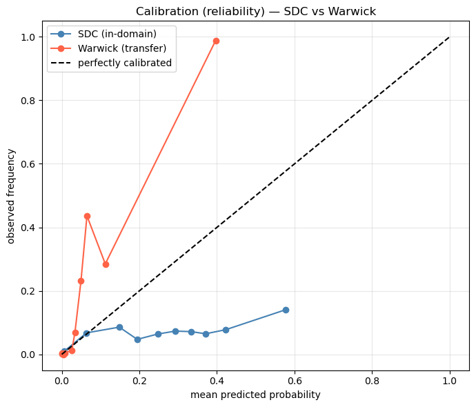

# Analysis: Baselines, Confidence Intervals, and Whether the Label Is Real

Two notebooks that interrogate the rest of the project. One asks whether the ML detector is actually better than the simple rules it claims to beat; the other asks whether the thing it is detecting is worth detecting.

## Problem

By this point the pipelines report AUC ≈ 0.90 for multipath detection. Two objections remain unanswered:

1. **Is that better than a one-line rule?** GNSS practice has used C/N₀ thresholds and elevation masks for decades. A machine-learning detector has to beat them on the same held-out data, with uncertainty quantified, or it is not worth the complexity.
2. **Is the label measuring anything?** Every score is computed against the device's `MultipathIndicator`. If that flag does not correspond to measurements that actually corrupt the position, then a detector that predicts it perfectly is still useless.

The second question turned out to decide the shape of the whole project.

## Data

Pooled SDC-2023 measurements with ground-truth trajectories, plus the Warwick simulation for the cross-domain comparison.

| | |
|---|---|
| Pooled for the label analysis | **281,109 measurements** across 6 drives |
| Device flag rate | 7.7% |
| Residual-fault rate (\|r\| > 15 m) | 6.3% |

Needs `data/03_processed/sdc2023_training_features.csv` and `seq_warwick`/Warwick features.

All validation is **session-grouped**, with folds split by drive and never by row, because the labels are temporally autocorrelated and a random row split leaks badly.

## Method

| Notebook | What it does |
|---|---|
| `interpretability_baselines.ipynb` | Classical GNSS baselines (C/N₀ threshold, elevation mask) vs RF on an identical held-out-drive split; bootstrap 95% confidence intervals; grouped 5-fold CV; precision-recall curves; cross-domain SHAP |
| `residual_label_integrity.ipynb` | Builds a **physics-based residual label** from post-fit residuals against the true trajectory, tests its association with the device flag (χ², φ, odds ratio, permutation test), compares predictability of both labels, builds an epoch-level integrity model, examines calibration across domains, and benchmarks boosters/ensembles |

The residual label is the key construction: instead of asking the chipset what it thinks, compute what the measurement's error actually was relative to ground truth, and threshold that.

## Results

### The ML detector does beat the classical rules

Held-out-drive test:

| Detector | ROC-AUC |
|---|---|
| C/N₀ threshold (classical) | 0.574 |
| elevation mask (classical) | 0.570 |
| RF, shared features only | 0.620 |
| **RF, full feature set** | **0.841** |

<p align="center">
  
</p>

Grouped 5-fold CV on the full RF: **AUC 0.836 ± 0.015** (per-fold 0.807–0.849), a tight spread across drives, so the margin over the classical rules is not a lucky split. Bootstrap 95% CIs are computed for the C/N₀ rule, RF-shared and RF-full.

Note the gap between **RF-shared (0.620)** and **RF-full (0.841)**. Most of the ML advantage comes from features the classical rules never had access to, chiefly the receiver's reported uncertainties, not from a cleverer decision boundary over C/N₀ and elevation. Restricted to the classical inputs, the model is only modestly ahead.

### The same physics in simulation and reality

<p align="center">
  
</p>

Mean |SHAP| share: **SDC**: C/N₀ 0.325, elevation 0.324 (evenly split). **Warwick**: C/N₀ 0.808 (dominant).

Both domains key on the same two physical quantities. The simulation leans harder on C/N₀ because its SNR is noise-free, so it is simply the more reliable discriminator there. The mechanism is shared; the weighting differs with data quality.

### The label is the problem

<p align="center">
  
</p>

Across **281,109 measurements**, the device flag and the residual-fault label overlap on **2,077** of 17,791 residual-faults and 21,746 device-flags:

| Statistic | Value |
|---|---|
| χ²(1) | 412.8, p < 10⁻⁹⁰ |
| **φ (= Cramér's V)** | **0.038** |
| **Odds ratio** | **1.64** |
| Permutation test | p < 0.0001 |
| Shared variance (φ²) | ≈ 0.15% |
| AUC(\|residual\| → flag) | 0.566 |
| point-biserial r | ≈ −0.001 |

**This is the project's central finding, and it depends on reading the statistics correctly.** The χ² is overwhelmingly significant, and it means almost nothing. With N ≈ 281,000, significance is nearly guaranteed; the question is effect size, and φ = 0.038 with an odds ratio of 1.64 is **negligible**. The two labels share about 0.15% of their variance. The device `MultipathIndicator` carries essentially no information about which measurements actually corrupt the position.

The residual label is **not harder to learn**; it is simply a different, and more useful, target:

| Label | Grouped-CV AUC |
|---|---|
| device flag | 0.825 |
| **residual-fault** | **0.827** |

This is what makes the finding actionable rather than merely critical. Switching to a physics-based label costs nothing in predictability and gains a target that corresponds to real positioning error. It is why `../positioning/position_mitigation.ipynb` finds device-flag exclusion worthless (−0.1%) while residual-fault exclusion gives +12.4%.

### Integrity and calibration

Predicting a worst-10% epoch (grouped CV):

| Predictor | AUC |
|---|---|
| multipath fraction | 0.534 |
| **post-fit residual median** | **0.615** |
| full epoch-feature RF | 0.568 |

<p align="center">
  
</p>

The calibration curves show why cross-domain transfer needs an explicit threshold recalibration rather than just a retrained scaler: the probability mapping shifts between domains even when the ranking holds (see `../warwick_multipath/`, where AUC 0.94 coexists with recall 0.21 at the default threshold).

Boosters and ensembles change nothing material: held-out RF 0.805 · HistGBM 0.809 · Voting(RF+HGB) 0.805. **The ceiling here is the label, not the model class.** That is consistent with `../attention_brnn/`, where sequence models also fail to improve on tabular baselines.

## How to run

Needs `data/03_processed/sdc2023_training_features.csv` (from `../2023_notebooks/` 01 → 03), SDC-2023 ground truth, and Warwick features (from `../warwick_multipath/warwick_simulation_deepdive.ipynb`) for the cross-domain SHAP section.

```bash
cd GNSS_Multipath_Project/notebooks_python/analysis
jupyter lab
```

Either order, since the two notebooks are independent:

```bash
python -m nbconvert --to notebook --execute --inplace interpretability_baselines.ipynb
python -m nbconvert --to notebook --execute --inplace residual_label_integrity.ipynb
```

Needs `shap` on top of the base requirements, and keep `numpy < 2`, since `shap` will otherwise pull NumPy 2.x and break the NumPy-1.x-compiled pandas build. Bootstrap CIs and the permutation test over 281k rows take ~10–15 minutes.
