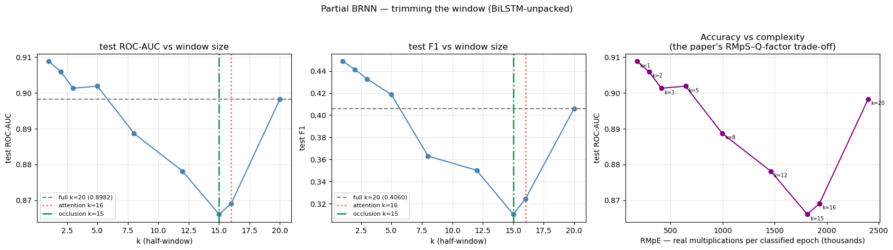

# Attention-Aided Partial Bidirectional RNN for Multipath / NLOS Detection

PyTorch adaptation of

> X. Liu et al., *"Attention-aided partial bidirectional RNN-based nonlinear equalizer in coherent optical systems"*, **Opt. Express 30**(18), 2022.

## Problem

Every other detector in this project classifies a measurement in isolation. But a satellite being blocked by a building is not an instantaneous event: the obstruction persists as the vehicle drives past it, so neighbouring epochs of the same satellite track ought to carry information.

Two questions follow:

1. **Does temporal context improve detection?** If multipath has exploitable temporal structure, a sequence model should beat the tabular baselines.
2. **If it does, how much context is actually needed?** The paper's contribution is that attention can *measure* this: read the useful span off the attention profile, then build a trimmed "partial" model over just that span at a fraction of the cost.

The paper equalises an optical symbol from a window of *k* preceding + *k* succeeding symbols using a BiLSTM/BiGRU, applies Bahdanau-style additive attention (Eq. 7–13) over the BRNN hidden states to discover which symbols matter, and matches baseline performance at ~56% lower complexity. Here the same machinery classifies a GNSS measurement from a window of neighbouring epochs **of the same satellite track**, replacing the paper's MSE regression head with a single logit + BCE loss.

## Data

| | |
|---|---|
| SDC-2023 sequences | windowed satellite tracks from `data/02_interim/sdc2023_epochs.csv` |
| Warwick sequences | windowed tracks from the ray-traced simulation |
| Window | 2k+1 epochs centred on the target measurement, k swept 1–20 |
| Split | **held-out drive**, never a random row split |
| Caches | `data/03_processed/seq_sdc2023.npz`, `seq_warwick.npz` |

**Temporal persistence**: P(multipath at +Δ | multipath now), the thing the sequence models are supposed to exploit:

| | +1 s | +20 s | base rate |
|---|---|---|---|
| SDC | 48% | 28% | 6% |
| Warwick | 98% | 79% | 20% |

Real data is far less persistent than the simulation. That gap foreshadows the result.

## Method

| File | What it does |
|---|---|
| `01_windowing.ipynb` | Builds windowed satellite-track sequences for SDC-2023 and Warwick. Defines tracks, segments, the held-out-drive split and the two feature schemas. Writes `seq_*.npz` |
| `02_sdc_attention_brnn.ipynb` | Trains BiLSTM/BiGRU × packed/unpacked attention on SDC-2023, reads the useful window off the attention and occlusion profiles, retrains a trimmed partial model across a `k` sweep, compares against RF / HistGBM re-fit on the same split |
| `03_attention_transfer.ipynb` | Applies the SDC-trained model to Warwick sequences, repeats window discovery on Warwick independently, compares the discovered window shapes |
| `attn_brnn.py` | Shared library: windowing, attention block and models, training loop, complexity accounting, window-discovery metrics |

Run in order: 02 needs 01's cache, 03 needs 02's checkpoint.

### Model

`AdditiveAttention` implements the paper's alignment model over BRNN hidden states:

```
e_t = v^T tanh(W h_t + b)      single-layer perceptron alignment
a   = softmax(e)               over the 2k+1 window positions
c   = sum_t a_t h_t            context vector
```

`AttnBRNN` wraps it in both variants from the paper:

- `attn='packed'` (§3.2.1): attention on the concatenated hidden state `[h_fwd ; h_bwd]`
- `attn='unpacked'` (§3.2.2): independent alignment models per direction, giving two attention profiles and so revealing an asymmetric window
- `attn='none'`: ablation, classify from the centre position's hidden state

## Results

**Temporal context does not improve accuracy.** SDC held-out-drive test, k = 20:

| Model | ROC-AUC | F1 |
|---|---|---|
| **HistGradientBoosting** (tabular baseline) | **0.902** | **0.429** |
| BiLSTM (no attention) | 0.901 | 0.417 |
| BiLSTM + attention | 0.898 | 0.406 |
| Random Forest | 0.888 | 0.423 |
| MLP-centre (single epoch) | 0.893 | 0.372 |
| BiGRU | 0.865 | 0.352 |

The tabular baseline wins. A single-epoch MLP is within 0.01 AUC of the full bidirectional sequence model. Attention makes things slightly *worse*.

**And the window sweep confirms why:** the best window is **k = 1**, scoring **AUC 0.909**, the highest number in the experiment. Attention and occlusion both nominate a ~±15-epoch span (attention k = 16, occlusion k = 15), but trimming to it costs accuracy rather than saving it (k = 16 vs k = 20: RMpE −19.5%, F1 −20%).

<p align="center">
  
</p>

**The multipath signal is essentially instantaneous.** What a measurement looks like right now tells you nearly everything; its neighbours add almost nothing. This is consistent with the SHAP results elsewhere: the dominant features are per-measurement signal quality and receiver uncertainty, which carry no temporal component.

What the method does deliver is **efficiency and interpretability**: k = 1 needs **175,616 RMpE** against k = 20's **2,398,464**, roughly **14× cheaper** *and* more accurate. The paper's window-discovery machinery works; it just reports that the useful window here is one epoch wide.

**Sequence transfer**, by contrast, is a strong result:

| | AUC |
|---|---|
| BiLSTM SDC → Warwick, **SDC scaling** | **0.99** |
| BiLSTM SDC → Warwick, own scaling | 0.58 |
| Warwick-trained (in-domain) | 0.9996 |

The 0.99 vs 0.58 gap is the same lesson as the tabular transfer in `../warwick_multipath/`: **apply the source domain's scaling, not the target's**. Re-standardising on the target erases the absolute C/N₀ level that carries the physics. Warwick's own k-sweep is flat and again favours k = 1 (RMpE 131k vs 1.79M at k = 20), so both datasets independently agree the useful window is minimal.

## Notes carried over from the data

Things established while building this that are easy to get wrong:

- **`sdc2023_epochs.csv` has no `utcTimeMillis`**: the parser drops it at export. Use `GpsTimeNanos`; no session spans a GPS week rollover.
- **A satellite track is not `(session, device, Svid)`.** That key leaves 334,455 duplicate rows: the pixel7pro tracks L1 and L5 simultaneously, and `Svid` repeats across constellations. Use `(session, device, ConstellationType, Svid, CarrierFrequencyHz)`.
- **`BasebandCn0DbHz`, `SnrInDb`, `AgcDb` are 100% NaN** in this dataset.
- **`AccumulatedDeltaRangeUncertaintyMeters` is a sentinel** (float32 max) on 32.8% of rows, meaning "carrier phase unusable": informative (12.4% multipath vs 4.4%) but encoded as a flag plus a value, never log-scaled raw.
- **Parameter count cannot express the partial-model saving.** RNN weights are shared across time, so trimming the window leaves parameters unchanged; the meaningful complexity axis is the paper's RMpS, reported here as **RMpE** (real multiplications per classified epoch).
- **`03_2023_classification.ipynb` has no stored outputs** and uses a stratified random row split, which leaks badly for temporally autocorrelated labels. Its baselines are therefore re-fit inside notebook 02 on the identical held-out-drive split rather than quoted.

## How to run

Needs `data/02_interim/sdc2023_epochs.csv` (from `../2023_notebooks/01_2023_data_parser.ipynb`) and Warwick features (from `../warwick_multipath/warwick_simulation_deepdive.ipynb`).

```bash
cd GNSS_Multipath_Project/notebooks_python/attention_brnn
jupyter lab
```

In order, since each depends on the previous:

1. `01_windowing.ipynb` → writes `data/03_processed/seq_sdc2023.npz`, `seq_warwick.npz`
2. `02_sdc_attention_brnn.ipynb` → writes `data/03_processed/attn_brnn/sdc_attn_brnn.pt` and the result CSVs
3. `03_attention_transfer.ipynb` → needs 02's checkpoint

Headless:

```bash
python -m nbconvert --to notebook --execute --inplace 01_windowing.ipynb
```

### Environment

Requires `torch` (a CUDA build was used here) and `torchinfo` on top of the project stack. Both were installed into the Anaconda base environment the other notebooks use.

The `k` sweep in notebook 02 trains a model per window size across several architectures: budget **1–2 hours on a GPU**, considerably longer on CPU. `01_windowing` is memory-hungry: the SDC sequence cache is ~76 MB on disk and larger in RAM while building.

Model checkpoints and `.npz` caches are gitignored; regenerate them by running the notebooks.
