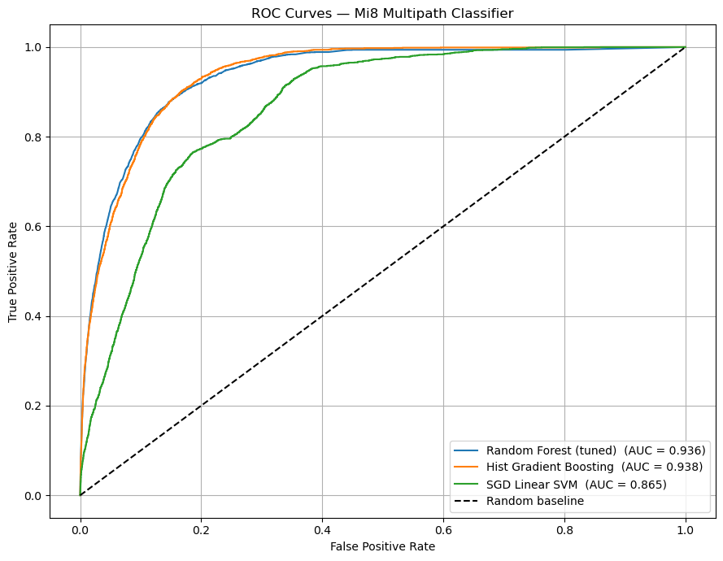

# Xiaomi Mi8: Single-Device Pipeline

## Problem

Every other pipeline here pools devices. This one restricts to a **single handset model**, which removes device-to-device variation in antenna, chipset and firmware from the picture entirely. If detection still works, the signature survives without any cross-device averaging to help it; and the severe class imbalance (3.2% positive) makes this the cleanest place to see what imbalance handling does to precision.

## Data

**Xiaomi Mi8 subset** of the SDC logs, with the device `MultipathIndicator` label, no SPAN time-sync.

| | |
|---|---|
| Rows | 333,070 · 18 columns |
| Class balance | 322,280 clean / **10,790 multipath (3.2%)** |
| Test split | 66,614 rows (64,456 clean / 2,158 multipath) |
| Features | 17 after engineering, 8 scaled |

`AgcDb` is partly missing and is imputed with the **training-set median (48.69)**, fitted on train only, applied to test.

## Method

| Notebook | What it does |
|---|---|
| `01_mi8_data_parser.ipynb` | Parses the Mi8 logs → `data/02_interim/mi8_epochs.csv` |
| `02_mi8_eda.ipynb` | Class distribution, feature distributions, constellation breakdown, correlation analysis |
| `03_mi8_classification.ipynb` | SMOTE → RandomizedSearchCV-tuned RF, HistGradientBoosting, SGD linear SVM; confusion matrices, ROC, F1 comparison, feature importance |

**Imbalance handling:** SMOTE on the training set only, balancing 333k rows up to **515,648 (257,824 each class)**. Hyperparameter search runs on a 20,000-row balanced subsample for tractability (`max_depth=None, min_samples_leaf=1, n_estimators=200`; CV F1 0.896 *on the balanced subsample*).

## Results

<p align="center">
  
</p>

| Model | ROC-AUC | Multipath P | R | F1 | Accuracy |
|---|---|---|---|---|---|
| **Random Forest (tuned)** | 0.936 | 0.35 | 0.55 | **0.425** | 0.95 |
| Hist Gradient Boosting | **0.938** | 0.19 | 0.84 | 0.31 | 0.88 |
| SGD Linear SVM | 0.865 | 0.10 | 0.80 | 0.17 | 0.75 |

Best model: **Random Forest (tuned), F1 = 0.4247**.

Two things this pipeline shows clearly:

- **Ranking is good; thresholded precision is not.** AUC 0.936 says the model orders measurements well, but at 3.2% prevalence a recall of 0.55 still costs precision 0.35. HistGBM trades the other way, with recall 0.84 at precision 0.19. Neither is a free lunch; the operating point is a deployment choice.
- **The balanced CV F1 of 0.896 is not a real score.** It is measured on the SMOTE-balanced subsample. On the genuine imbalanced test set the same model gets 0.425. Honest cross-validation on the original distribution gives **F1 0.227 ± 0.042** (5-fold, 50k subsample), a reminder of how much SMOTE-era numbers flatter themselves.

The AUC here is comparable to the SDC-2023 pipelines (~0.90), so single-device restriction costs little. The gap between AUC and F1 is an artefact of prevalence, not of the device.

## How to run

Needs the Mi8 logs in `data/01_raw/`.

```bash
cd GNSS_Multipath_Project/notebooks_python/mi8_multipath
jupyter lab
```

In order:

1. `01_mi8_data_parser.ipynb` → `data/02_interim/mi8_epochs.csv`
2. `02_mi8_eda.ipynb`
3. `03_mi8_classification.ipynb` → `data/03_processed/mi8_training_features.csv`

Headless:

```bash
python -m nbconvert --to notebook --execute --inplace 03_mi8_classification.ipynb
```

Needs `imbalanced-learn` for SMOTE on top of the base requirements. Notebook 03 takes ~10 minutes, mostly in the hyperparameter search.
