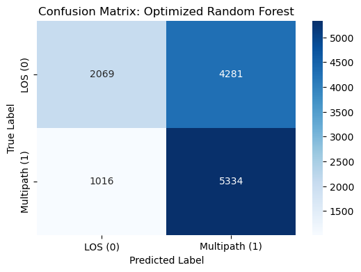

# 2020 Pixel Drives: Error-Labelled Baseline (SPAN Time-Sync)

The earliest pipeline in the project, and the one that produced its most consequential negative result.

## Problem

Every other pipeline here predicts the device's own `MultipathIndicator` flag. This one asks a harder and more honest question: can you predict **actual positioning error**?

The 2020 SDC collection pairs each phone with a **SPAN** inertial/GNSS reference system giving centimetre-level ground truth. That allows a label defined by consequence rather than by the chipset's opinion: an epoch is labelled multipath-affected if the phone's position differs from SPAN by more than **10 m**. The device flag is then handed to the model as a *feature*, which makes this a direct test of a question the rest of the project returns to: **does the device flag, plus signal strength, tell you anything about whether the position is actually wrong?**

## Data

**2020 SDC drives** (`2020-05-14-US-MTV-*` through `2020-08-*`): Pixel 4 / 4XL / 4XL-Modded logs plus SPAN NMEA reference tracks.

| | |
|---|---|
| Rows after sync | 63,496 (50,796 train / 12,700 test) |
| Label | `is_multipath` = Haversine(chipset, SPAN) **> 10 m** |
| Class balance | 50 / 50, balanced by construction |
| Features | 4: `Cn0DbHz`, `MultipathIndicator`, `Cn0DbHz_Category_Medium`, `Cn0DbHz_Category_Strong` |

Download from [kaggle.com/competitions/google-smartphone-decimeter-challenge](https://www.kaggle.com/competitions/google-smartphone-decimeter-challenge) into `data/01_raw/`.

> **Label caveat:** `Position_Error_Meters` is an **epoch-level** quantity broadcast onto **per-measurement** rows. Every satellite in a bad epoch inherits the label, including the ones that were fine. It is a coarse proxy; the properly per-measurement version of this idea is the residual-fault label in `analysis/residual_label_integrity.ipynb`.

## Method

| Notebook | What it does |
|---|---|
| `01_data_parser_sync.ipynb` | Parses Pixel GNSS logs and SPAN NMEA, **time-synchronises** the two, computes Haversine position error, thresholds at 10 m → `data/02_interim/time_synced_epochs.csv`. Includes a coordinate-uniqueness diagnostic to catch a failed merge broadcasting one coordinate across all rows |
| `02_exploratory_data_analysis.ipynb` | Class balance, C/N₀ vs position error correlation, pairplot, feature selection, scaling → `data/03_processed/training_features_labels.csv` |
| `03_classification_model.ipynb` | GridSearchCV-tuned Random Forest (`n_estimators` ∈ {100,200}, `max_depth` ∈ {10,20,None}, scored on F1) and an SVM baseline; confusion matrix, ROC, feature importance |

Stratified 80/20 split. Because the classes are balanced by construction, **accuracy is interpretable here** and 50% is the chance floor.

## Results

**It barely beats chance.**

| Model | Accuracy | Precision | Recall | F1 |
|---|---|---|---|---|
| Random Forest (tuned) | **0.583** | 0.555 | 0.840 | 0.668 |
| SVM (baseline) | 0.520 | 0.512 | 0.865 | 0.643 |

<p align="center">
  
</p>

Read the confusion matrix rather than the F1. The model predicts **multipath for 9,615 of 12,700 test epochs**: it recovers 5,334 of 6,350 true positives (recall 0.84) by calling almost everything positive, and misclassifies 4,281 of 6,350 clean epochs as multipath. The healthy-looking F1 of 0.668 is an artefact of high recall on a balanced set; precision is 0.555, i.e. **5.5 percentage points above coin-flipping**.

### Why this matters

C/N₀ and the device `MultipathIndicator`, the two things a receiver readily gives you, carry **almost no information about whether the position is actually wrong**. That is not a failure of tuning or of model class. It is the same finding that `analysis/residual_label_integrity.ipynb` later pins down rigorously across 281,109 measurements: the device flag's association with real measurement error is negligible (**φ = 0.038, OR = 1.64**).

The contrast with the rest of the repository is the point:

| Label | Best AUC |
|---|---|
| device `MultipathIndicator` (SDC-2023, 24 features) | **0.90** |
| actual position error > 10 m (here, 4 features) | ~chance |

The detector that scores 0.90 elsewhere is scoring 0.90 *against the chipset's own flag*. This pipeline shows what happens when you ask the same inputs about ground truth instead. It is the reason the project pivots toward residual-based labels and toward `positioning/position_mitigation.ipynb`, where excluding device-flagged measurements is confirmed to change horizontal error by −0.1%.

Some of the gap is the coarse epoch-level label and the deliberately minimal 4-feature set; a fairer per-measurement comparison is in `analysis/`. The direction of the result, though, survives every refinement.

## How to run

Needs the 2020 drives (phone logs **and** SPAN NMEA) in `data/01_raw/`.

```bash
cd GNSS_Multipath_Project/notebooks_python/pixel
jupyter lab
```

In order:

1. `01_data_parser_sync.ipynb` → `data/02_interim/time_synced_epochs.csv`
2. `02_exploratory_data_analysis.ipynb` → `data/03_processed/training_features_labels.csv`
3. `03_classification_model.ipynb`

Headless:

```bash
python -m nbconvert --to notebook --execute --inplace 01_data_parser_sync.ipynb
```

Check the coordinate-uniqueness diagnostic in notebook 01 before trusting anything downstream: if the SPAN/chipset merge misaligns, it silently broadcasts a single coordinate across every row and the label becomes meaningless. Route maps for these collection days are in `../00_coordinate_maps.ipynb`.
