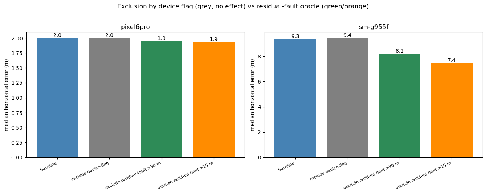
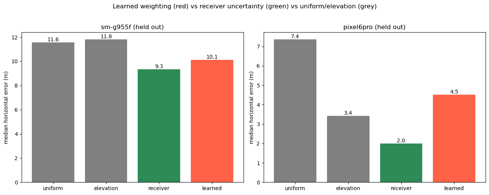

# Positioning: Does Detecting Multipath Actually Improve the Fix?

The question most multipath-detection papers stop short of. A detector with AUC 0.90 is only worth having if acting on it moves the position.

## Problem

The implicit promise of multipath detection is: flag the bad measurements, drop them, get a better position. This notebook tests that promise end to end: build a real weighted-least-squares solver, then try every obvious way of acting on a detection and measure the horizontal error that comes out.

Three mitigation strategies, plus the question of what detection is *for* if they fail:

1. **Exclude** measurements flagged by the device `MultipathIndicator`.
2. **Down-weight** them rather than dropping them.
3. **Learn** a measurement weighting, and see if it beats the receiver's own uncertainty model.

And as a control: exclude the measurements that are *actually* faulty, judged against the true trajectory. That is an oracle and not deployable, but it bounds what any detector could ever buy you.

## Data

SDC-2023 sessions with ground-truth trajectories, per-measurement rows with raw pseudorange, satellite positions, receiver uncertainties and the device flag. Two devices carry the analysis because they bracket the quality range:

| Device | Baseline median horizontal error | 95th percentile |
|---|---|---|
| **pixel6pro** | 2.00 m | (good receiver) |
| **sm-g955f** (`routen`) | **9.35 m** | 29.8 m (worst session surveyed) |

Most sessions sit at 2–4 m median / 4–10 m at the 95th percentile.

Needs `data/03_processed/sdc2023_training_features.csv` and the raw SDC-2023 ground truth.

## Method

**The solver is built and validated first.** A WLS position is computed per epoch from raw pseudoranges with satellite clock, ionospheric and tropospheric corrections, weighted by receiver-reported uncertainty. Validation against the shipped `WlsPosition`: **0.064 m median agreement**, close enough that any difference measured afterwards is attributable to the mitigation, not to solver error.

Then each strategy re-solves every epoch with modified measurement handling, and the resulting horizontal error distributions are compared. **RAIM** (classical post-fit residual screening) is included as the established-practice baseline.

The **learned weighting** experiment trains a model to predict per-measurement uncertainty and feeds it into the WLS weight matrix, evaluated on held-out drives against uniform weighting, elevation weighting, and the receiver's own uncertainty.

## Results

### Excluding device-flagged measurements does nothing

<p align="center">
  
</p>

Median horizontal error (m):

| Method | pixel6pro | sm-g955f |
|---|---|---|
| baseline | 2.00 | 9.35 |
| exclude device-flag | 2.00 (**−0.1%**) | 9.43 (**−0.9%**) |
| down-weight device-flag | 2.00 | 9.42 |
| RAIM (post-fit residual vs WLS) | 1.95 (+2%) | 9.33 (0%) |
| **exclude residual-fault > 30 m** *(oracle)* | 1.95 (+2.5%) | **8.19 (+12.4%)** |
| exclude residual-fault > 15 m *(oracle)* | 1.93 (+3.2%) | 7.43 (+20.5%)* |

\* the 15 m variant improves the median but blows up the mean: it drops so many measurements that geometry degrades and some epochs fail badly. The 30 m threshold is the defensible operating point.

**The decisive comparison is the last two rows against the third.** Exclusion as a technique is not the problem; excluding the *right* measurements delivers a 12.4% improvement on a poor receiver. Excluding the device-flagged ones delivers nothing, because the flag is uncorrelated with which measurements carry real error (φ = 0.038; see `../analysis/residual_label_integrity.ipynb`).

**So the bottleneck is fault identification, not fault exclusion.** The headroom exists; the device flag simply does not point at it. A residual-based detector is the deployable target.

The residual-fault rows are an **oracle**: they use the true trajectory to decide what to drop. They establish an upper bound, not an achievable system.

### Learned weighting loses to the chipset

<p align="center">
  
</p>

Median horizontal error (m), held-out drives:

| Weighting scheme | sm-g955f | pixel6pro |
|---|---|---|
| uniform | 11.55 | 7.36 |
| elevation | 11.81 | 3.42 |
| **receiver uncertainty** (baseline) | **9.35** | **2.00** |
| learned uncertainty | 10.14 (−8.5%) | 4.51 (−126%) |

The learned model comfortably beats uniform weighting; it has learned something real. It loses to the receiver's own uncertainty on **both** devices, and badly on the good one. **The chipset's uncertainty model is already near-optimal**, informed by correlator-level information no post-hoc model can see. Replacing it with a learned weighting is a step backwards.

### Multipath as an integrity signal

If detection cannot improve the fix, can it at least warn you when not to trust it? Predicting whether an epoch lands in the worst 10% of error:

| Predictor | AUC |
|---|---|
| multipath fraction (pixel6pro) | 0.48 |
| multipath fraction (sm-g955f) | 0.58 |
| post-fit residual median | **0.615** |
| full epoch-feature RF | 0.568 |

The device flag's multipath fraction is **at chance** on the good receiver. The classical post-fit residual is the best integrity predictor available here, and it is a solver output rather than a learned detection.

## Reading these results

The honest summary is that **this notebook is a sequence of negative results around one positive one**. Device-flag exclusion: no effect. Down-weighting: no effect. Learned weighting: worse than the chipset. Integrity from the flag: at chance.

The positive result is that excluding genuinely faulty measurements *does* work (+12.4%), which locates the problem precisely: the label, not the pipeline. Combined with the φ = 0.038 finding, this is the project's central argument: detection research built on the device `MultipathIndicator` optimises against a target that does not predict positioning error, and the field's effort belongs on **residual-based fault identification** instead.

Detection's value is also plausibly **upstream** (integrity monitoring) and **downstream** (map-aiding, sensor fusion) rather than in WLS measurement weighting, where the receiver already does well.

## How to run

Needs `data/03_processed/sdc2023_training_features.csv` (from `../2023_notebooks/` 01 → 03) and SDC-2023 ground-truth trajectories in `data/01_raw/sdc2023/`.

```bash
cd GNSS_Multipath_Project/notebooks_python/positioning
jupyter lab
```

```bash
python -m nbconvert --to notebook --execute --inplace position_mitigation.ipynb
```

Self-contained once the SDC-2023 features exist. **Check the solver validation cell first.** It should report ~0.064 m median agreement with the shipped `WlsPosition`; if it does not, nothing downstream is meaningful. Re-solving every epoch under six mitigation schemes across two devices takes ~15–20 minutes. Writes `data/03_processed/ai_corrected_track.csv`.
