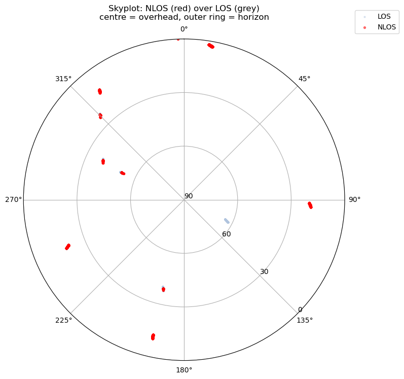
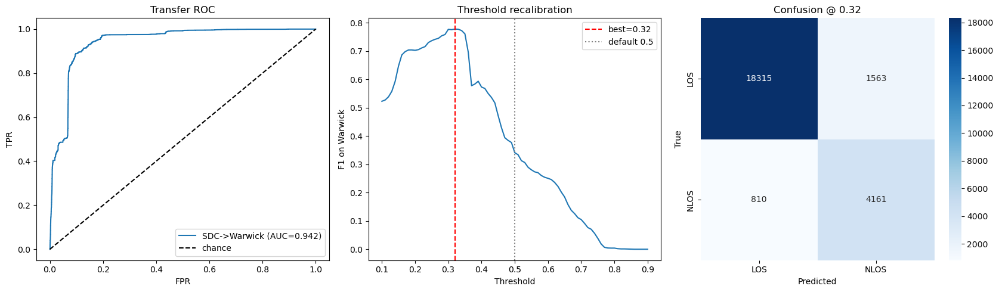
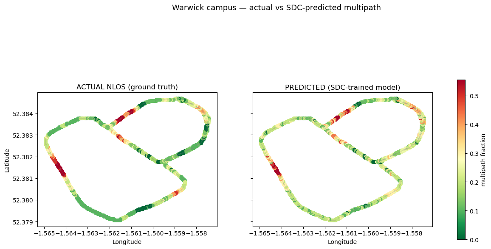

# Warwick Simulation: Deep Dive & Cross-Domain Transfer

## Problem

Every result on the SDC data is measured against the device's own `MultipathIndicator`, a flag whose relationship to physical reality is exactly what is in question. This module breaks that circularity by introducing a dataset with **ground truth from ray tracing**, where whether a signal is line-of-sight is known by construction rather than reported by a chipset.

That buys two things:

1. **An honest in-domain ceiling.** What does the detection problem look like when the label is physically exact?
2. **A transfer test.** A model trained on real smartphone data, applied to an independently generated physics simulation of a completely different location. If the same features drive predictions in both, the model has learned multipath physics, not dataset-specific quirks.

## Data

**Warwick simulation**: ray-traced GNSS over a drive around the University of Warwick campus (~52.38°N, 1.56°W, Coventry).

| | |
|---|---|
| Size | 24,849 measurements · 2,842 epochs |
| NLOS rate | **20.0%** |
| Constellation | GPS-only, ~11 satellites visible |
| Label | `Visibility`: **2** = DIRECT (LOS) · **1** = INDIRECT (NLOS) · **0** = not visible |
| Source files | `Visibility.m`, `Constellation.m` (elevation, azimuth), `Channels.m` (SNR, power) |

Place the simulation export in `data/01_raw/Warwick/`. The simulation is not publicly redistributable; the parser in `warwick_simulation_deepdive.ipynb` documents the expected `.m` format.

> **The label is NLOS, not "detected multipath".** It is a different definition from the SDC flag: stricter and physically exact. Comparisons across the two domains are comparisons across two label definitions, which is itself part of the finding.

**The domain shift that governs everything here:** SDC median C/N₀ is **32.2 dB-Hz**; Warwick's is **44.8 dB-Hz**. A ~13 dB offset between a real phone antenna and an idealised simulated receiver.

## Method

| Notebook | What it does |
|---|---|
| `warwick_simulation_deepdive.ipynb` | Parses the simulation `.m` exports → route map → EDA (LOS vs NLOS distributions, elevation profile, skyplot) → in-domain Random Forest with threshold tuning → SHAP |
| `sdc_to_warwick_transfer.ipynb` | Trains on SDC-2023, tests on Warwick using a **shared feature schema**; calibration analysis, threshold recalibration, per-epoch campus maps, hotspot extraction, and the reverse sim → real direction |

Transfer uses only features both domains possess (C/N₀, elevation, azimuth) and, critically, **raw, un-standardised C/N₀**.

## Results

### In-domain: the problem is nearly trivial when the label is exact

| | LOS | NLOS |
|---|---|---|
| median SNR | 45.3 dB-Hz | **23.6 dB-Hz** |
| median elevation | 37.9° | **11.4°** |
| median power | −159 dBW | **−181 dBW** |

NLOS is **90.8%** of measurements at 0–10° elevation and **0%** above 60°.

<p align="center">
  
</p>

In-domain Random Forest: **AUC ≈ 0.9996, F1 ≈ 0.98**. SHAP: `power_dbW` 0.219 · `snr_dbHz` 0.217 · `elevation` 0.008, almost entirely signal-strength-driven.

**This number is not a success, it is a calibration point.** A ray-traced simulation has no antenna pattern noise, no diffraction ambiguity, no firmware heuristics. A near-perfect score tells you the simulation is clean, not that detection is solved. Its value is as a ceiling against which the messy real-world 0.90 can be read.

### Transfer: real → sim works, with one specific requirement

<p align="center">
  
</p>

| Setup | Result |
|---|---|
| RF, shared features, **raw C/N₀** | **AUC 0.934–0.942** |
| …at the default 0.5 threshold | recall 0.21–0.25, badly over-conservative |
| …**threshold recalibrated to ~0.2–0.32** | **F1 0.73–0.78, recall 0.84** |
| C/N₀ **standardised per-domain** | **AUC 0.31**, worse than chance |
| **Sim → real** (train Warwick, test SDC) | **AUC 0.62**, fails |

Three things follow.

**Per-domain standardisation destroys the signal.** The intuitive fix for a 13 dB offset, z-scoring each domain separately, is exactly wrong. The absolute C/N₀ level *is* the physics; standardising away the offset also standardises away the information. Raw values plus a recalibrated decision threshold is the correct handling.

**The threshold does not transfer even when the ranking does.** AUC 0.94 with recall 0.21 is a pure calibration failure: the model orders measurements correctly but its probabilities are shifted. This is quantified in `analysis/residual_label_integrity.ipynb`.

**Transfer is directional.** Real → sim succeeds; sim → real collapses to 0.62. Real data contains the simulation's clean signature plus the messiness, so a real-trained model recognises the clean case. A sim-trained model has never seen noise, diffraction or firmware artefacts, and does not generalise down to them. **Training a multipath detector on simulation alone will not work.**

### Spatial agreement on the campus

<p align="center">
  
</p>

Per-epoch multipath fraction: **MAE 0.071, Pearson r 0.80**, epoch-level agreement **90.7%**, notably stronger spatial correlation than the within-SDC maps achieve (r ≈ 0.30–0.37), because the simulation's geometry is deterministic.

Campus hotspots extracted for site visits (lat, lon, satellite bearing): 52.38167, −1.56433 (W) · 52.38133, −1.56433 (WNW) · 52.38400, −1.55767 (SW) · 52.38200, −1.56467 (WSW) · 52.38433, −1.55800 (SSE) · 52.38333, −1.56200 (E).

Cross-domain SHAP confirms the mechanism is shared; see `analysis/interpretability_baselines.ipynb`, where SDC splits attention evenly between C/N₀ (0.325) and elevation (0.324) while Warwick is C/N₀-dominated (0.808): the same physics, weighted differently because the simulation's SNR is cleaner.

## How to run

Needs `data/01_raw/Warwick/` (simulation export) and, for the transfer notebook, `data/03_processed/sdc2023_training_features.csv` from `2023_notebooks/` 01 → 03.

```bash
cd GNSS_Multipath_Project/notebooks_python/warwick_multipath
jupyter lab
```

In order:

1. `warwick_simulation_deepdive.ipynb`, standalone, needs only the simulation export
2. `sdc_to_warwick_transfer.ipynb`, which **needs the SDC-2023 feature table to exist first**

Headless:

```bash
python -m nbconvert --to notebook --execute --inplace warwick_simulation_deepdive.ipynb
```

Needs `shap` and `folium` on top of the base requirements. The campus maps render Folium tiles and need a live browser; static scatter fallbacks are included for headless runs. The sequence-model counterpart to the transfer experiment is `../attention_brnn/03_attention_transfer.ipynb`.
