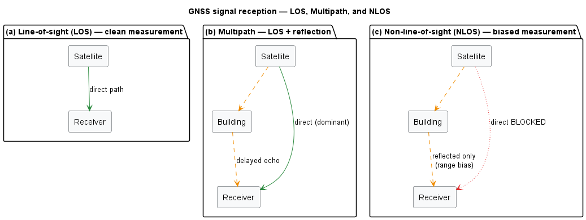
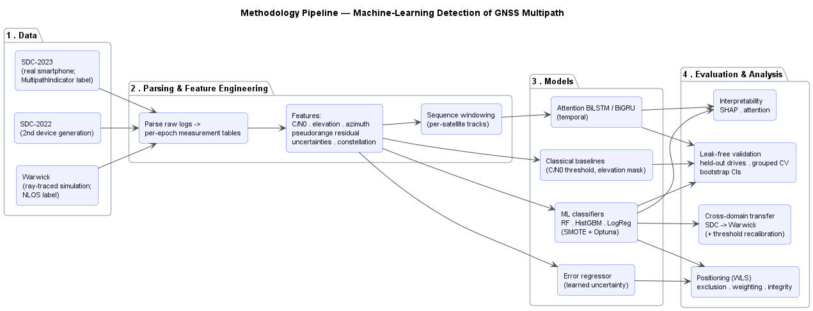
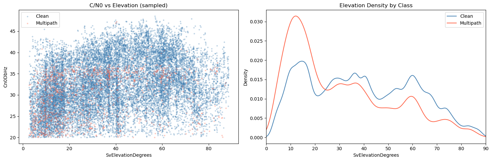
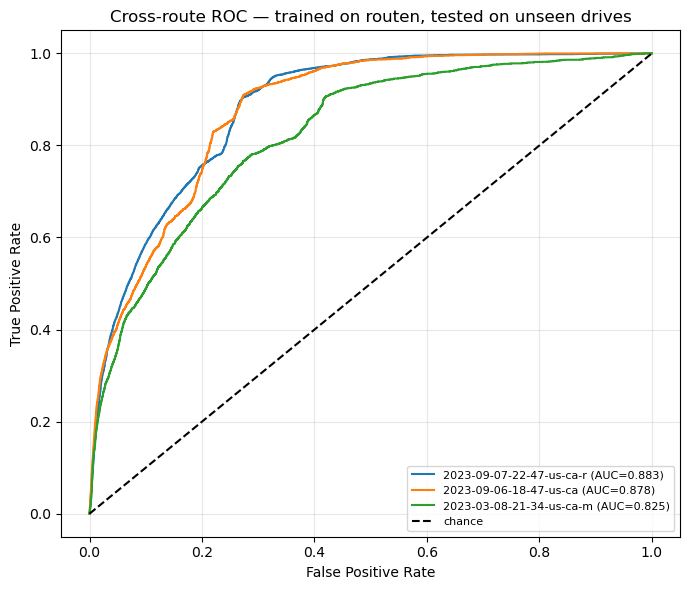

# GNSS Multipath Detection for Reliable Navigation

Detecting GNSS **multipath / NLOS** (signals that reach the receiver via reflections off buildings and terrain) from the signal quality and geometry of individual measurements, and asking how robust, interpretable, and *useful* that detection actually is for trustworthy positioning.

> **Research question:** How reliably can GNSS multipath be detected from the signal-quality and geometry of individual measurements, and is that detection robust, interpretable, and useful enough to support trustworthy positioning?

MSc dissertation code (University of Warwick). Every number in this repository comes from a stored notebook run; nothing here is illustrative.

<p align="center">
  
</p>

---

## The problem

A GNSS receiver assumes each satellite signal travelled in a straight line. In cities it often has not: the signal bounces off a building first (**multipath**), or the direct path is blocked entirely and only a reflection arrives (**NLOS**). The reflected path is longer, so the pseudorange is too long, and the computed position is wrong, by metres in an urban canyon.

The reflection leaves a signature in the measurement itself: lower carrier-to-noise density (C/N₀), low elevation angle, inflated receiver-reported uncertainty. This project asks whether a model can learn that signature, whether it survives moving to unseen routes and to an independent physics simulation, what it has actually learned, and (the question most papers skip) whether detecting multipath improves the position you get out the other end.

---

## Data

None of it is redistributed here (see [Getting the data](#getting-the-data)).

| Dataset | Size | Multipath / NLOS | Label | Notes |
|---|---|---|---|---|
| **Google SDC 2023** | 761,597 meas · 17 sessions | ~7.0% | device `MultipathIndicator` | pixel6pro, pixel7pro, sm-g955f populate the flag. 721,832 rows after feature cleaning (6.3%) |
| **Google SDC 2022** | 592,004 rows · 7/9 sessions | ~5.6% | device `MultipathIndicator` | mi8, pixel6pro, pixel7/7pro, sm-g988b, samsungs21ultra |
| **Xiaomi Mi8 subset** | 333,070 rows | 3.2% | device `MultipathIndicator` | single device generation, no time-sync |
| **Warwick simulation** | 24,849 meas · 2,842 epochs | 20.0% NLOS | ray-traced `Visibility` | GPS-only, ~52.38°N 1.56°W. 2 = LOS, 1 = NLOS, 0 = not visible |
| **2020 Pixel drives** | 63,496 rows (balanced) | 50% (balanced) | SPAN ground-truth time-sync | earliest pipeline, 4 features |

**The domain shift that matters:** SDC median C/N₀ is 32.2 dB-Hz, Warwick's is 44.8 dB-Hz, a ~13 dB offset that has to be handled explicitly for any transfer to work.

---

## Method

<p align="center">
  
</p>

Each dataset runs the same spine (**parse → engineer features → EDA → classify → interpret**), then four cross-cutting experiments sit on top:

1. **Detection & generalisation.** Tuned Random Forest / HistGradientBoosting per measurement, validated by *held-out drive*, never by random row split (the labels are temporally autocorrelated, so a row split leaks badly).
2. **Transfer.** Train on real smartphone data, test on the ray-traced campus simulation, and back.
3. **Temporal modelling.** Attention-aided partial BiRNN over windows of the same satellite track, to ask whether multipath has exploitable temporal structure.
4. **Positioning.** A validated WLS solver, then: does excluding or down-weighting detected measurements actually reduce horizontal error?

---

## Results

| Question | Answer |
|---|---|
| **Can multipath be detected from measurements?** | **Yes.** Tuned RF / HistGradientBoosting reach **ROC-AUC ≈ 0.90**, far above classical single-threshold rules (**0.841 vs 0.574** C/N₀ threshold, 0.570 elevation mask, on held-out drives). |
| **Does it generalise?** | **Yes.** Trained on some drives, it holds on **completely unseen drives at AUC 0.839–0.900**, with *no location feature*. It catches multipath by its physical signature, not by memorising places. Grouped 5-fold CV: **AUC 0.836 ± 0.015**. |
| **Does it transfer to an independent scenario?** | **Yes, but only with care.** The Warwick simulation is caught at **AUC 0.934–0.942** (sequence model 0.99), but only with **raw C/N₀ + decision-threshold recalibration**. Standardising C/N₀ per-domain *destroys* it (**AUC → 0.31**). The reverse direction, sim → real, **fails at AUC 0.62**. |
| **Do temporal / attention models help?** | **No accuracy gain.** The multipath signal is essentially instantaneous: the best window is **k = 1**. Attention buys **interpretability** (a ~15-epoch useful span) and a **~14× cheaper** partial model, not accuracy. |
| **Is the ground-truth label trustworthy?** | **Barely.** The device `MultipathIndicator`'s association with measurements that carry real errors is **negligible**: **φ = 0.038, odds ratio 1.64** over 281,109 measurements. χ²(1) = 412.8, p < 10⁻⁹⁰, significant *only* because N is large; φ² ≈ 0.15% shared variance. It is also constellation-biased. |
| **Does detection improve positioning?** | **Only if you exclude the *right* measurements.** Excluding by the **device flag** does nothing (−0.1% / −0.9%, it is error-uncorrelated). Excluding the **actually-faulty** measurements (residual vs true trajectory) improves horizontal error **12.4%** on a poor receiver. Learned soft re-weighting still **loses** to the receiver's own uncertainty model. The bottleneck is *fault identification*, not exclusion. |

### The physical signature the model keys on

<p align="center">
  
</p>

Multipath concentrates at the horizon: **15.3%** of measurements below 15° elevation are flagged, falling monotonically to **4.3%** above 60°. The lowest bin alone carries **43% of all multipath from 29% of measurements**.

### It generalises to unseen drives

<p align="center">
  
</p>

| Unseen drive | rows | % multipath | F1 | recall | ROC-AUC |
|---|---|---|---|---|---|
| `…22-47-routebc2` | 60,714 | 10.8 | 0.515 | 0.75 | **0.900** |
| `…09-06-18-47` | 42,257 | 7.9 | 0.474 | 0.58 | **0.898** |
| `…03-08-mtv-u` | 25,664 | 10.6 | 0.421 | 0.73 | **0.839** |

### But the label is the weak link

<p align="center">
  
</p>

Median horizontal error (m), WLS solver validated to **0.064 m** against the shipped `WlsPosition`:

| Method | pixel6pro | sm-g955f |
|---|---|---|
| baseline | 2.00 | 9.35 |
| exclude device-flag | 2.00 (−0.1%) | 9.43 (−0.9%) |
| RAIM (post-fit residual) | 1.95 (+2%) | 9.33 (0%) |
| **exclude residual-fault > 30 m** *(oracle)* | 1.95 (+2.5%) | **8.19 (+12.4%)** |

This is the central finding: the detector works, but it is trained on a label that does not track real measurement error. A **residual-based detector** is the deployable target.

---

## Repository structure

```
GNSS_Multipath_Project/
├── notebooks_python/
│   ├── 2023_notebooks/      SDC-2023 pipeline + single-drive deep dive   → README
│   ├── 2022_notebooks/      SDC-2022 pipeline                            → README
│   ├── mi8_multipath/       Xiaomi Mi8 pipeline                          → README
│   ├── pixel/               2020 Pixel pipeline (SPAN time-sync)         → README
│   ├── warwick_multipath/   campus simulation + SDC→Warwick transfer   → README
│   ├── attention_brnn/      attention-aided partial BiRNN                → README
│   ├── positioning/         WLS solver + mitigation experiment           → README
│   ├── analysis/            classical baselines, CIs, label integrity    → README
│   └── 00_coordinate_maps.ipynb
└── scripts_matlab/          NMEA/RTK validation utilities                → README

docs/figures/                result figures referenced by these READMEs
```

Each subfolder has its own README with the problem it addresses, its data, its method, its real numbers, a figure, and how to run it.

---

## Getting the data

The repository is code-only. `GNSS_Multipath_Project/data/` is gitignored and must be populated before anything runs:

```
GNSS_Multipath_Project/data/
├── 01_raw/
│   ├── sdc2023/              # Kaggle: smartphone-decimeter-2023
│   ├── 2020-*-US-MTV-*/      # Kaggle: google-smartphone-decimeter-challenge (2021)
│   └── Warwick/              # simulation export: Visibility.m, Constellation.m, Channels.m
├── 02_interim/               # created by the parser notebooks
└── 03_processed/             # created by the feature notebooks
```

- **SDC 2023**: [kaggle.com/competitions/smartphone-decimeter-2023](https://www.kaggle.com/competitions/smartphone-decimeter-2023) (`device_gnss.csv`, `ground_truth.csv`)
- **SDC 2022 / 2020 drives**: [kaggle.com/competitions/google-smartphone-decimeter-challenge](https://www.kaggle.com/competitions/google-smartphone-decimeter-challenge)
- **Warwick simulation**: a ray-traced simulation of a drive around the University of Warwick campus. Not publicly redistributable; the parser in `warwick_multipath/` documents the expected `.m` export format.

`02_interim/` and `03_processed/` are regenerated by running the parser notebooks; do not copy them in.

---

## Running it

```bash
git clone https://github.com/RoshanBM/Dissertation_Trial.git
cd Dissertation_Trial
python -m venv .venv && .venv\Scripts\activate      # Windows
pip install -r requirements.txt
jupyter lab
```

The attention models additionally need `torch` (a CUDA build was used here) and `torchinfo`.

> **NumPy pin:** keep `numpy < 2`. `shap` will try to pull NumPy 2.x, which breaks the NumPy-1.x-compiled pandas build this project runs against.

To execute a notebook headless:

```bash
python -m nbconvert --to notebook --execute --inplace <notebook>.ipynb
```

**Suggested order for a fresh run** (later notebooks read earlier caches):

1. `2023_notebooks/` 01 → 02 → 03, which writes `data/02_interim/sdc2023_epochs.csv` and `data/03_processed/sdc2023_training_features.csv`
2. `2023_notebooks/04_2023_routen_deepdive`
3. `warwick_multipath/warwick_simulation_deepdive` → `sdc_to_warwick_transfer`
4. `attention_brnn/` 01 → 02 → 03
5. `positioning/position_mitigation`
6. `analysis/interpretability_baselines`, `analysis/residual_label_integrity`

The `2022_notebooks/`, `mi8_multipath/` and `pixel/` pipelines are independent and can be run in any order.

---

## Caveats

Carried throughout the analysis, and stated here because they bound every number above:

1. The device `MultipathIndicator` means *detected multipath*, not strictly NLOS. It is **constellation-biased** and has only a **negligible association with real measurement errors** (φ = 0.038, OR = 1.64). This is the central acknowledged limitation.
2. The Warwick label is **NLOS**, a different definition, and the simulation is idealised and **GPS-only**.
3. Real-world generality rests on **cross-route SDC** evidence. Real → sim is the *easy* transfer direction; sim → real fails (AUC 0.62).
4. Cross-dataset transfer needs **raw C/N₀ plus threshold recalibration**, not per-domain standardisation, which breaks it.
5. Attention / temporal modelling provides **interpretability and efficiency, not accuracy**.
6. The residual-fault exclusion result is an **oracle / upper bound**: it uses the true trajectory. It establishes that the headroom exists and that fault identification is the bottleneck, not that a deployable system achieves 12%.
7. `03_2023_classification.ipynb` and `03_2022_classification.ipynb` use a stratified random row split, which leaks for temporally autocorrelated labels. Their baselines are re-fit on a proper held-out-drive split inside `attention_brnn/02` and `analysis/`; quote those, not these.

---

## Acknowledgements

Smartphone GNSS logs from the **Google Smartphone Decimeter Challenge** (2021–2023). `scripts_matlab/utils/` adapts Google's reference NMEA/RTK evaluation tools. The attention architecture follows Liu et al., *"Attention-aided partial bidirectional RNN-based nonlinear equalizer in coherent optical systems"*, Opt. Express **30**(18), 2022.
